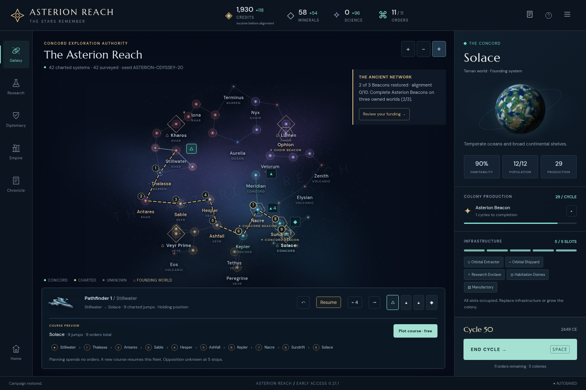

# Asterion Reach

A desktop-first, turn-based space 4X built with Three.js. Guide the Concord through a fallen interstellar civilization: explore star lanes, settle worlds, recover ancient knowledge and compete with three autonomous rival powers.

[Play Asterion Reach](https://l3g5.github.io/awesome_4x/) · [Player Field Guide](https://l3g5.github.io/awesome_4x/guide.html) · [Development and evidence](docs/development.html)



*An actual ODYSSEY cycle-50 save, imported into version 0.21.1 for this read-only preview. [Source and exact-state verification](docs/handoff-review/preview.json).*

## Play

The seeded galaxy contains 42 systems and four civilizations. Orders limit what your empire can accomplish each cycle; fleet movement has its own allowance. Expansion, infrastructure slots and colony charters make economic choices consequential.

- Explore discoveries with lasting choices, restoration projects and shared historical records.
- Research twelve technologies, develop specialized colonies and assemble military formations.
- Negotiate funded trade and peace offers, manage treaty notice periods and respond to border disputes.
- Split, merge, repair and hold fleets; inspect invasion forecasts and recorded combat exchanges.
- Win by holding all four founding worlds, maintaining a funded Beacon network, or leading in Legacy at the final cycle.

The game autosaves in your browser. Export a JSON campaign from the menu to keep a backup or move it to another browser. The in-game Field Guide explains the rules and controls.

## Run locally

Requires Node.js 22 or newer.

```sh
npm ci
npm run dev
```

For a production build:

```sh
npm run build
npm run preview
```

The simulation in `src/game.js` is independent of rendering. Separate modules handle rival strategy, diplomacy, sensors, colony development, navigation, discoveries, victory and historical reports. `src/galaxy.js` renders the Three.js map; `src/main.js` coordinates player interaction.

## Validate and investigate

```sh
npm test
npx playwright install chromium
npm run test:browser
```

Set `PLAYWRIGHT_BASE_URL` to check an already-served build. Chromium acceptance is automated; the [bounded Firefox review](docs/firefox-review/index.html) records the specific additional workflows and browser version checked.

The [development index](docs/development.html) organizes played campaigns, exact replays, mechanics reviews, controlled AI comparisons, save compatibility and artwork. It preserves each report's source pins and distinguishes historical measurements from current behavior. Open `/docs/development.html` through the local development server to browse the HTML reports. [PROGRESS.md](PROGRESS.md) records each stage's goals, results and deployment checks; [docs/API.md](docs/API.md) describes the engine interface.

The completed [Odyssey](docs/odyssey-playtest/index.html), [fortified-network WATCH](docs/watch-playtest/index.html) and [military campaign](docs/military-playtest/report.html) preserve actual UI play and independent reconstruction. For example:

```sh
node docs/odyssey-playtest/verify.mjs
node docs/odyssey-playtest/replay.mjs --out /tmp/odyssey-reproduction
```

## Deploy

GitHub Actions installs dependencies, runs rules and browser tests, builds the static game and deploys `dist/` to GitHub Pages. Relative asset paths support repository subpaths. The workflow uses `contents: read`, `pages: write` and `id-token: write`.

Production `build-info.json` identifies the version and source commit. Fonts and visual assets are self-hosted, with third-party licenses under `public/licenses/`. Runtime gameplay needs no account, backend or external CDN.
